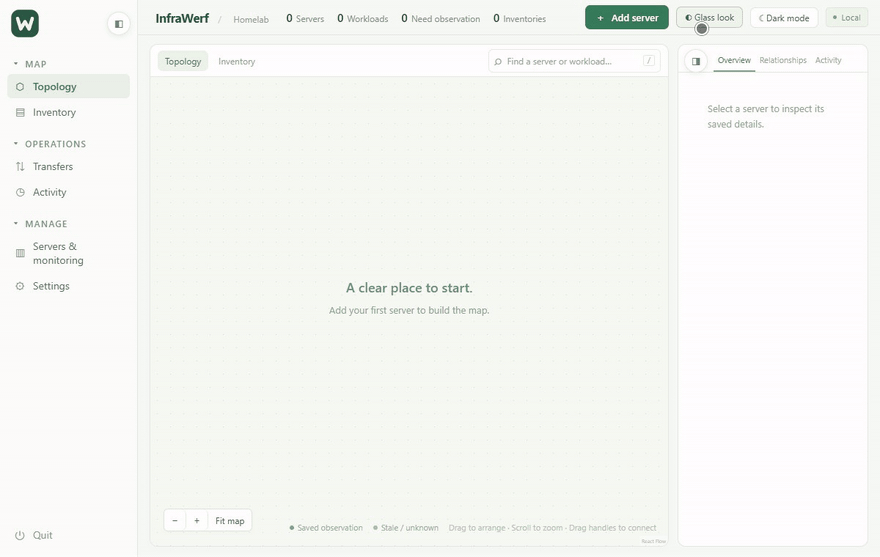
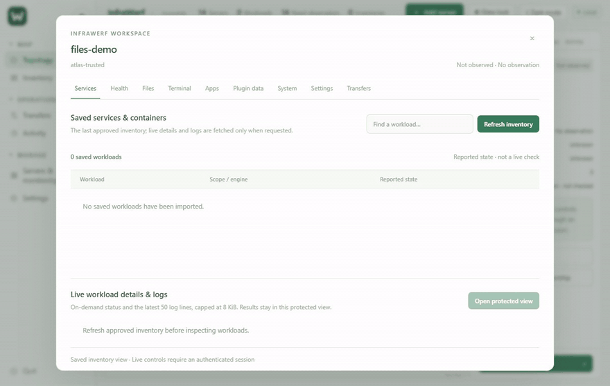
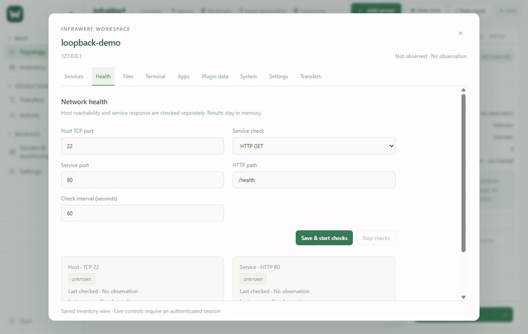

<p align="center"></p>

InfraWerf is a Windows desktop app for servers you run yourself. It shows them on a map. For each server it lists saved inventory and health, browses and transfers files over SFTP, opens a terminal, and inspects and controls systemd, Podman and Docker workloads. It connects through your existing OpenSSH setup and saves its data on your PC.

[](docs/install.md)
[](#licence)
[](docs/build.md)
[](docs/plugins.md)

## What it does

| Area | Behaviour |
| --- | --- |
| Map | Server cards and directed relationships that you add and arrange. Positions and links are saved. |
| Server workspace | Saved inventory with search, health, and the server's workloads. |
| Health | TCP and HTTP checks. Results are healthy, unhealthy, stale or unknown. Stale means the last result is old, not that the server is down. |
| Files | SFTP browser. Create folder, rename, move and delete need a confirmation that shows the exact path. Nothing is overwritten and directories are not deleted recursively. |
| Transfers | Uploads and downloads with progress, cancel and a SHA-256 check. |
| Terminal | Interactive shell over an authenticated SSH session. |
| Services and containers | Shows systemd, Podman and Docker state and recent logs. Start, stop and restart ask for a fresh password each time. |
| Apps | Opens a web app on a server's localhost through a tunnel to a local port on your PC. |
| Plugins | Add tabs, badges, read-only commands and jobs. A plugin gets only the permissions you grant it. |
| Lock | Ends every protected session and clears what they showed. |

InfraWerf uses your system OpenSSH and your own keys. It does not copy private keys and does not edit your known-hosts file. Data is fetched through an authenticated session when you open it, and saved observations show the time they were taken.

## Demo

These recordings come from the app itself, using a throwaway workspace and local test servers. They contain no real hosts.

**Map.** Add servers and document how they relate.



**Files.** Open an SFTP session over strict host trust, look at a file, open a folder, then lock the session.



**Health.** Run a TCP check and an HTTP check. The service is stopped partway through, so its result changes to unhealthy.



The interface talks only to the Rust core. The core keeps the SQLite database and reaches servers through your system OpenSSH. See the [security model](docs/security.md).

## Install

Windows 11 x64. It has been tested only on Windows 11 x64; other Windows versions have not been tried.

1. Get `InfraWerf_<version>_x64-setup.exe` from the release you were given.
2. Run it. It installs for your user and needs no administrator prompt.
3. Open InfraWerf from the Start menu.

The installer is not code-signed yet, so Windows may show a warning. See [docs/install.md](docs/install.md) for updating, uninstalling and where data is stored.

To add your first server, create an entry on the map, set its hostname to the alias in your OpenSSH config, then open its Settings and run Verify SSH access. The [user guide](docs/user-guide.md#first-steps) covers the steps.

## Build from source

```bash
mise trust
mise install
mise run deps
mise run check
mise run smoke:desktop
```

You need [mise](https://mise.jdx.dev/), the Microsoft C++ Build Tools and WebView2. See [docs/build.md](docs/build.md).

## Documentation

| Topic | Page |
| --- | --- |
| Install | [docs/install.md](docs/install.md) |
| Using the app | [docs/user-guide.md](docs/user-guide.md) |
| What it reads and changes | [docs/security.md](docs/security.md) |
| Data location, backup, reset | [docs/data-and-backup.md](docs/data-and-backup.md) |
| Problems and fixes | [docs/troubleshooting.md](docs/troubleshooting.md) |
| Building and tests | [docs/build.md](docs/build.md), [docs/testing.md](docs/testing.md) |
| Plugins | [docs/plugins.md](docs/plugins.md), [author guide](docs/plugin-api/guide.md), [manifest reference](docs/plugin-api/README.md) |
| Compatibility between versions | [docs/COMPATIBILITY.md](docs/COMPATIBILITY.md) |
| Contributing | [CONTRIBUTING.md](CONTRIBUTING.md) |
| Security reports | [SECURITY.md](SECURITY.md) |

The full index is [docs/README.md](docs/README.md).

## Status

- The Windows 11 x64 desktop app is the release target and the only platform it has been tested on. Current version: 0.1.13.
- A phone interface and Android packaging are planned and not part of this release.
- `atlas.py` is an earlier Python prototype. The desktop app does not read or write its data. See [docs/data-and-backup.md](docs/data-and-backup.md#the-python-reference).
- Installers are not code-signed.

The project's plan, decisions and test evidence are under [`agent/`](agent/AGENT.md). The [roadmap](ROADMAP.md) lists what is next.

## Contributing

Most new features fit better as plugins in their own repository. Read [CONTRIBUTING.md](CONTRIBUTING.md) before opening a pull request.

## Licence

InfraWerf is licensed under either of the [MIT licence](LICENSE-MIT) or the [Apache licence, version 2.0](LICENSE-APACHE), at your option. Plugins are their authors' own works under the licences their authors choose.
